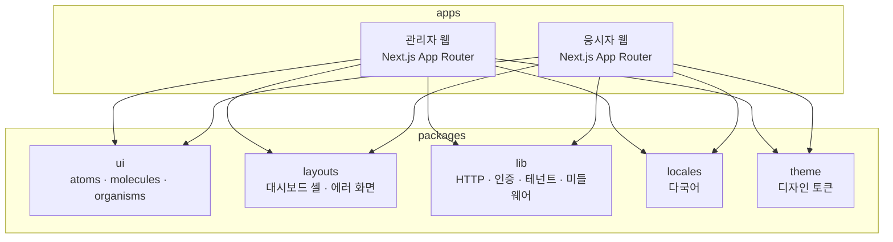
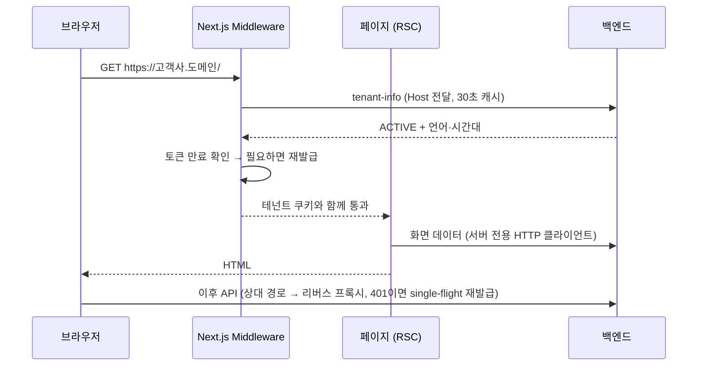

# 전체 구조

실무 프로젝트(멀티테넌트 온라인 평가 플랫폼)의 프론트엔드 구조를 회사 정보 없이 정리한 문서입니다.

## 모노레포

- pnpm workspaces로 앱 2개가 공유 패키지를 함께 씁니다.
- **공유 패키지는 앱 설정을 직접 import하지 않습니다.** 앱마다 다른 값(홈 경로, 메뉴 데이터 등)은 Provider나 prop으로 주입합니다. 공유 컴포넌트가 다른 앱의 설정을 몰래 읽는 사고를 ESLint 규칙으로 막았습니다.

## 요청 한 건의 흐름

## 환경 설정 원칙

고객사 도메인이 계속 늘어나므로 **한 번 만든 빌드를 모든 도메인에서 그대로 쓸 수 있어야** 합니다.

- 빌드 시점에 박히는 `NEXT_PUBLIC_*`에 도메인·고객사별 값을 두지 않습니다.
- 백엔드 주소는 런타임 환경변수 하나로만 받습니다.
- 브라우저는 항상 상대 경로로 요청하고, 앞단 리버스 프록시가 백엔드로 보냅니다. 절대 URL을 쓰면 접속 도메인과 요청 도메인이 어긋나 테넌트가 틀어집니다.

## 에러 화면

- 404 / 403 / 500 화면 UI는 공유 패키지 한 곳에만 있고, 각 앱의 에러 파일은 라우팅 껍데기입니다.
- API의 401 / 403은 HTTP 인터셉터가 관리자·응시자 스코프에 맞는 안내 화면으로 보냅니다.

## 관련 결정 기록

- [001. 토큰 재발급을 single-flight로](decisions/001-single-flight-token-refresh.md)
- [002. 테넌트 조회 실패를 "없는 테넌트"로 보지 않기](decisions/002-tenant-unavailable-vs-not-found.md)
- [003. UI와 HTTP 사이에 Data 층 두기](decisions/003-data-layer-boundary.md)
