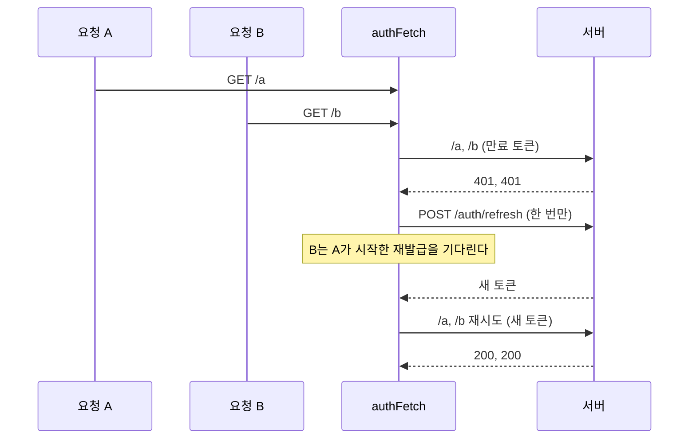

# JWT 자동 재발급

## 문제

대시보드처럼 한 화면에서 API를 5~10개 동시에 부르는 상황에서 access token이 만료되면
401이 한꺼번에 돌아옵니다. 요청마다 재발급 API를 부르면, refresh token을 한 번 쓰면
바꾸는(rotation) 서버에서는 두 번째 재발급부터 실패해 사용자가 갑자기 로그아웃됩니다.

## 해결

| 규칙 | 이유 |
|---|---|
| 재발급은 동시에 한 번만 | refresh token 회전 서버에서 중복 재발급은 곧 로그아웃 |
| 원 요청은 한 번만 재시도 | 새 토큰으로도 401이면 루프에 빠지지 않고 실패시킨다 |
| 서버가 세션 종료를 확정한 응답은 재발급하지 않음 | 유휴 만료된 세션을 refresh로 되살리지 않는다 |
| 재발급 도중 로그아웃·재로그인이 일어나면 늦게 온 토큰을 버림 | 다른 탭·다른 계정의 세션을 이전 토큰으로 덮어쓰지 않는다 |
| 토큰은 매 요청마다 원본(쿠키)에서 읽음 | 다른 탭이나 미들웨어가 갱신한 토큰이 바로 반영된다 |

## 파일

- [auth-fetch.ts](auth-fetch.ts): 구현 (의존성 없음, fetch 기반)
- [auth-fetch.test.ts](auth-fetch.test.ts): 위 규칙 6가지를 각각 검증

실무에서는 axios 인터셉터로 구현했고, 이 예제는 같은 규칙을 fetch 래퍼로 다시 작성했습니다.
