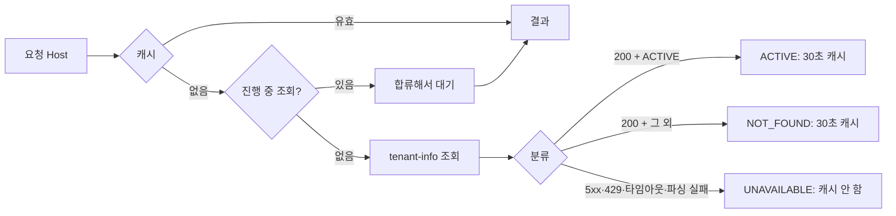

# 멀티테넌트 판정

## 문제

여러 고객사가 같은 프론트엔드 빌드를 각자의 도메인으로 씁니다. 도메인은 계속 늘어나므로
빌드 시점에 도메인별 값을 넣을 수 없고, 요청이 들어올 때 Host로 고객사를 판정해야 합니다.

이때 흔히 생기는 사고는 **백엔드가 잠깐 5xx를 냈을 뿐인데 모든 고객사에 "등록되지 않은 도메인"
화면이 뜨는 것**입니다. 조회 실패와 "없는 고객사"를 같은 분기로 처리했기 때문입니다.

## 해결



- **장애와 부재를 구분**: 근거가 확실할 때만 NOT_FOUND(404 안내), 나머지는 UNAVAILABLE(503 안내)
- **장애는 캐시하지 않음**: 백엔드가 복구되면 다음 요청부터 바로 정상 화면
- **TTL을 짧게**: TTL이 곧 "고객사 중지가 화면에 반영되는 최대 지연". 실제 차단은 백엔드가 한다
- **중복 조회 병합**: 페이지 문서와 prefetch가 동시에 와도 조회는 1건
- **캐시 상한**: Host 헤더는 요청자가 바꿀 수 있으므로 메모리가 무한히 늘지 않게 한다

## Next.js Middleware에 붙이는 방법

```ts
// middleware.ts
import { NextResponse, type NextRequest } from 'next/server'
import { createTenantResolver } from './tenant-resolver'

const resolver = createTenantResolver({
  fetchTenantInfo: async (host) => {
    const res = await fetch(`${process.env.SERVER_API_URL}/tenant-info`, {
      headers: { 'X-Forwarded-Host': host },
      signal: AbortSignal.timeout(5_000)
    })
    return { status: res.status, body: await res.json().catch(() => null) }
  }
})

export async function middleware(request: NextRequest) {
  const host = request.headers.get('x-forwarded-host') ?? request.nextUrl.host
  const result = await resolver.resolve(host)

  if (result.status === 'NOT_FOUND') {
    return NextResponse.rewrite(new URL('/tenant-unavailable', request.url), { status: 404 })
  }
  if (result.status === 'UNAVAILABLE') {
    return NextResponse.rewrite(new URL('/tenant-error', request.url), { status: 503 })
  }

  // 클라이언트가 다시 조회하지 않도록 테넌트 정보를 쿠키로 내려준다
  const response = NextResponse.next()
  response.cookies.set('tenant_id', result.tenant.tenantId, { path: '/', sameSite: 'lax' })
  return response
}
```

## 파일

- [tenant-resolver.ts](tenant-resolver.ts): 판정·캐시 로직 (프레임워크 무관)
- [tenant-resolver.test.ts](tenant-resolver.test.ts): 장애 분류, TTL, 복구, 중복 병합, 캐시 상한 검증
